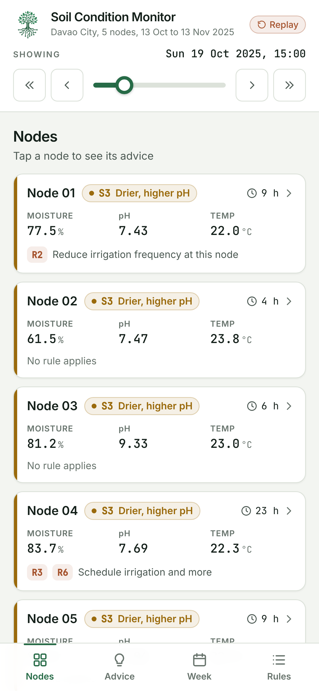
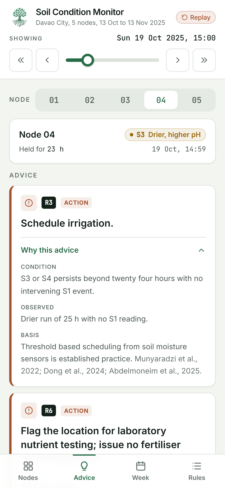
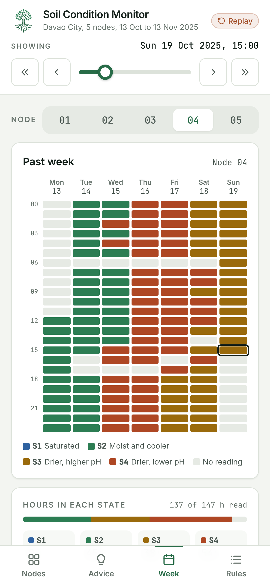

# Soil Condition Monitor

A minimal user application for the undergraduate thesis *Unsupervised Identification of Soil Condition States from Low Cost IoT Sensor Data with Random Forest Classification and a Threshold Based Expert System* (Ateneo de Davao University).

It shows, for five soil sensor nodes at a demonstration site in Davao City, the current soil condition state of each node, how long the node has held it, the past week of states, and the recommendation the rule base gives, with the rule that produced it and the published work behind that rule. It is designed first for smartphones.

The analysis that produces the states is in the root of this repository. Run every command below from this `monitor` folder.

<p>
  
  
  
</p>

## What it is, and what it is not

- It **replays** the recorded deployment of 13 October to 13 November 2025. It is not connected to the sensors.
- It reads the states from the output file of the analysis pipeline (`input/soil_states_k4.csv`), not from the Firebase database described in the thesis.
- The states are the reference states of the thesis, not states assigned live by the Random Forest.
- It has not yet been tested with farmers or extension agents.

## Run it

Open `app/index.html` in any browser. Nothing needs installing, and it works offline.

The bar at the top sets the hour of the record being shown. The bar at the bottom switches between four views:

| View | Shows |
| --- | --- |
| Nodes | Each node's state, hours held, latest reading, and the rules that apply, or that it is settling |
| Advice | Each active recommendation for the selected node, with its rule and, on request, the condition, the evidence, and the sources |
| Week | The selected node's states over the past seven days, and the hours spent in each |
| Rules | The eight rules of the rule base with their conditions and sources |

## Layout

```
app/        the web page (index.html, app.js, style.css, data.js, fonts, logo)
engine/     the rule engine and helper scripts (Python)
input/      the state of every reading, from the analysis pipeline
design/     the Tailwind CSS source for app/style.css
docs/       screenshots used in Appendix B of the thesis
```

## Rebuild

Rebuild `app/data.js` after changing the rules or the input (Python 3 with pandas and numpy):

```
python engine/build_data.py input/soil_states_k4.csv app/data.js
```

The script also prints how often each rule applies over the whole record, which should agree with the rule table of Chapter Four of the thesis (R3 once, at Node 04; R5 never; R6 at Node 04 only).

Rebuild `app/style.css` after changing classes in `app/index.html` or `app/app.js` (Node.js):

```
cd design
npm install
npm run build
```

Retake the screenshots (Python with playwright and its Chromium browser):

```
python engine/screenshots.py app/index.html docs/screenshots
```

## The rules

Rules R1 to R8 are those of the thesis rule base. The engine makes their conditions operational as follows.

| Rule | Applies when |
| --- | --- |
| R1 | S1 has lasted longer than the node's recovery interval (median of its earlier S1 recoveries; one hour until it has one) |
| R2 | S1 readings fall on four or more days of the current calendar week at the node |
| R3 | A run of S3 or S4 readings, counted together, is longer than 24 hours |
| R4 | The node is in S2 |
| R5 | A run of S4 is longer than 48 hours and the median of its valid pH readings is below 5.5 |
| R6 | The node's median conductivity to date is below that of every other node |
| R7 | A reading is outside its physical range (moisture 0 to 100 percent, pH 3 to 10, temperature 0 to 45 degrees, conductivity 0 to 2 dS/m) |
| R8 | Less than 24 hours have passed since the node's first reading; no other rule is shown |

Two readings count as consecutive when they are 45 to 75 minutes apart. Where no rule applies, the application says that no advice is given, and where several apply, all are shown, as the rule base defines no default and no precedence. The second condition of R7, all nodes stepping together, is not implemented.
